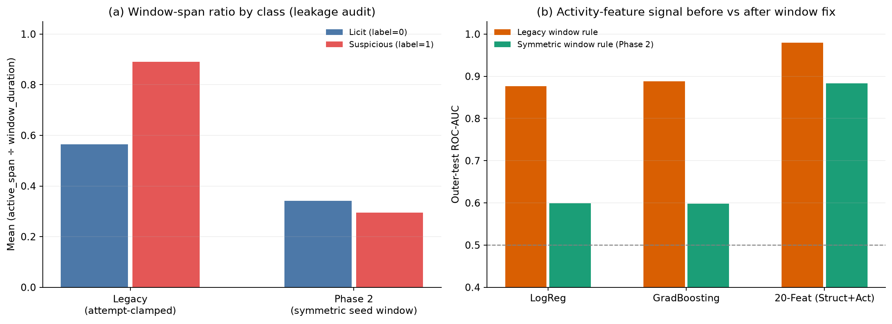

# AML Subgraph Construction Bias & Structural Graph Transfer — IBM AML HI-Small vs Elliptic2

[](https://github.com/IliaJakha/bank-account-fraud-risk-scoring/actions/workflows/ci.yml)

A rigorous empirical investigation of **candidate-construction bias**, **observation-window leakage**, and **cross-domain topological transfer** in directed financial transaction subgraphs (**IBM AML HI-Small** synthetic bank transfers vs **Elliptic2** Bitcoin cluster components).


---

## Headline Findings (Phase 2 Label-Blind Methodology)

1. **Most of the legacy IBM topological separation was a candidate-construction artifact — pure 14-feature topology is modest once both classes share one label-blind sampler.**
   - **Validation-selected 14-feature model (`LogReg`):** Selected strictly by mean inner-validation AP in both **4-fold rolling-origin temporal evaluation** (`val AP = 0.3571`) and **4-fold connected-component account-group evaluation** (`val AP = 0.4258`).
   - Replacing the legacy benchmark (documented laundering attempts vs licit BFS neighborhoods: `LogReg` test AP `0.5677` `[0.4643, 0.6677]`, `11.39×` lift, ROC-AUC `0.8769`) with a **single unified label-blind BFS sampler** (`10,000` candidates, `1,387` rolling-origin test positives and `2,730` account-group test positives across `4/4` estimable folds) reduces **`LogReg` ROC-AUC to `0.5995` `[0.5706, 0.6285]`** on rolling-origin folds (pooled AP `0.3959` `[0.3701, 0.4209]`, fold-mean AP `0.4301` `[0.1589, 0.7014]`, unweighted lift `1.37×` `[1.12×, 1.63×]`; IPW population-weighted AP `0.0404` at `0.0060` prevalence, IPW lift `3.99×`, IPW ROC-AUC `0.6132`) and **`0.6400` `[0.5976, 0.6824]`** on account-disjoint component folds (pooled AP `0.3538` `[0.3364, 0.3712]`, unweighted lift `1.57×` `[1.28×, 1.86×]`; IPW lift `5.63×`, IPW ROC-AUC `0.6928`).
   - All four 14-feature classifiers beat the 2-feature `SizeOnly` baseline significantly on paired out-of-fold tests (`LogReg` vs `SizeOnly` paired $\Delta\text{AP} = +0.1180$ `[+0.0999, +0.1385]`, $p = 0.001$; DeLong $\Delta\text{AUC} = +0.1199, p < 10^{-4}$), but differ negligibly from one another (`ROC-AUC 0.599–0.600` on rolling-origin).

2. **Eliminating the asymmetric window leak drops 20-feature ROC-AUC from `0.979` (and `0.999` stress) to `0.883–0.887`, while genuine intra-window burstiness remains informative within IBM.**
   - In the legacy benchmark, **`88.1%`** of positive windows clamped `t0` and `t1` to the exact first and last laundering transactions (`active_span / duration >= 0.99`), compared to only **`3.4%`** of negative windows.
   - Under the **Phase 2 symmetric seed-offset window rule** (`t0 = t_seed - offset`, `t1 = t0 + duration` drawn independently of labels), clamping drops to **`0.37%`** (positives) vs **`0.28%`** (negatives). Under this leak-free rule, `StructPlusActivity_20` achieves rolling-origin pooled AP **`0.7619` `[0.7385, 0.7844]`** (fold-mean AP `0.7434` `[0.5003, 0.9864]`, unweighted lift `2.51×` `[1.51×, 3.51×]`, ROC-AUC **`0.8831` `[0.8030, 0.9632]`**; IPW lift `25.71×`, IPW ROC-AUC `0.8023`) and account-group pooled AP **`0.7164` `[0.6986, 0.7339]`** (ROC-AUC **`0.8874` `[0.8211, 0.9537]`**, DeLong $p < 10^{-4}$ vs `LogReg`).

3. **Zero-shot cross-domain topological transfer between IBM AML HI-Small and Elliptic2 fails (`lift ≈ 1.0×`).**
   - `IBM → Elliptic2` tuned AP is `0.0223–0.0234` at `0.0227` prevalence (`0.99–1.03×` lift; `LogReg` AP `0.0223` `[0.0204, 0.0243]`), and within-Elliptic2 14-feature models remain near random (`AP 0.0238–0.0256`, `1.05–1.13×` lift), driven by tiny component sizes (mean `3.65` vs `10.20` nodes) and severe structural distribution shift (`deg_gini` KS `0.595`, `longest_chain_norm` KS `0.577`).

---

## Before vs After: Legacy Benchmark vs Phase 2 Label-Blind Benchmark (`IBM → IBM`)

`LogReg` is marked **`(Val-Selected)`** because it achieved the highest mean inner-validation AP among all 14-feature structural models in both Rolling-Origin (`0.3571`) and Account-Group (`0.4258`) regimes. Every fold exceeded the `>= 30` test-positive minimum (`222–612` positives/fold in Rolling-Origin; `477–1,141` positives/fold in Account-Group).

| Model | Legacy Benchmark AP (95% CI) | Legacy Lift / AUC | Phase 2 Rolling-Origin Pooled AP (95% Boot CI) | RO Fold Lift (95% CI) / AUC | Phase 2 RO IPW Pop. Lift / IPW AUC | Phase 2 Account-Group Pooled AP (95% Boot CI) | AG Fold Lift (95% CI) / AUC |
|---|---|---|---|---|---|---|---|
| `SizeOnly` *(2 feat)* | `0.2526` *(n/a)* | `5.07×` / `0.6050` | `0.2779` `[0.2641, 0.2951]` | `1.05×` `[0.85, 1.25]` / `0.5206` | `2.80×` / `0.6792` | `0.2615` `[0.2510, 0.2714]` | `0.98×` `[0.81, 1.15]` / `0.4609` |
| **`LogReg` *(Val-Selected, 14 feat)*** | `0.5677` `[0.4643, 0.6677]` | `11.39×` / `0.8769` | **`0.3959` `[0.3701, 0.4209]`** | **`1.37×` `[1.12, 1.63]` / `0.5995`** | **`3.99×` / `0.6132`** | **`0.3538` `[0.3364, 0.3712]`** | **`1.57×` `[1.28, 1.86]` / `0.6400`** |
| `RandomForest` *(14 feat)* | `0.5638` `[0.4581, 0.6712]` | `11.32×` / `0.8751` | `0.3981` `[0.3729, 0.4246]` | `1.37×` `[1.12, 1.61]` / `0.5996` | `4.61×` / `0.5752` | `0.3537` `[0.3361, 0.3706]` | `1.55×` `[1.18, 1.91]` / `0.6172` |
| `GradBoosting` *(14 feat)* | `0.6218` `[0.5227, 0.7199]` | `12.48×` / `0.8884` | `0.3614` `[0.3387, 0.3847]` | `1.37×` `[1.09, 1.64]` / `0.5986` | `4.15×` / `0.6058` | `0.3495` `[0.3332, 0.3671]` | `1.54×` `[1.16, 1.93]` / `0.6176` |
| `ExtraTrees` *(14 feat)* | `0.5798` `[0.4769, 0.6874]` | `11.64×` / `0.8849` | `0.3959` `[0.3711, 0.4219]` | `1.36×` `[1.11, 1.61]` / `0.5994` | `4.62×` / `0.6002` | `0.3708` `[0.3517, 0.3881]` | `1.57×` `[1.17, 1.97]` / `0.6193` |
| `StructPlusActivity_20` *(20 feat)* | `0.8602` *(clamped window)* | `17.26×` / `0.9792` | `0.7619` `[0.7385, 0.7844]` | `2.51×` `[1.51, 3.51]` / `0.8831` | `25.71×` / `0.8023` | `0.7164` `[0.6986, 0.7339]` | `2.99×` `[1.67, 4.30]` / `0.8874` |

*(Note on prevalence & lift: Legacy IBM test prevalence is `0.0498`. Phase 2 unweighted enriched prevalence is `0.3286` across Rolling-Origin folds and `0.2720` across Account-Group folds; inverse-probability weights `ipw_weight` re-weight candidates to the uniform-seed population prevalence of `0.0060–0.0070`.)*

---

## Diagnostic Visualizations

| Observation-Window Leakage Audit | Rolling-Origin vs Account-Group Multi-Fold Stability |
|---|---|
|  |  |

| Cross-Domain Legacy Lift (`IBM ↔ Elliptic2`) | IBM vs Elliptic2 Domain Shift (KS Statistics) |
|---|---|
|  |  |

---

## Quickstart

```bash
git clone https://github.com/IliaJakha/bank-account-fraud-risk-scoring.git
cd bank-account-fraud-risk-scoring
python -m venv .venv && source .venv/bin/activate
pip install -e ".[dev]"

# Offline Ruff lint & 20-test pytest suite (~20s, runs on committed tests/fixtures/)
make lint
make test

# Full end-to-end pipeline (~500 MB auto-download on first run, SHA-256 verified)
make data         # Download & verify pinned Hugging Face dataset files
make features     # Build legacy IBM (7,770) & Elliptic2 (121,810) feature tables
make experiments  # Run legacy benchmark, Unit 4/5 tuning, Extensions 1-12 & Phase 2
make phase2       # Run Phase 2 label-blind IPW methodology & figures standalone
make report       # Regenerate all evaluation & Phase 2 figures from saved CSVs
```

### Run with Docker

```bash
docker build -t aml-graph:latest .
docker run --rm aml-graph:latest test

mkdir -p data outputs
docker run --rm -v "$(pwd)/data:/app/data" -v "$(pwd)/outputs:/app/outputs" aml-graph:latest phase2
```

---

## Methodological Design

1. **Unified Label-Blind Candidate Sampler & Exact IPW (`src/aml_graph/sampling.py`):**
   - Generates `10,000` IBM candidates via one procedure (`common_bfs_candidate` on `idx.label_blind_view()`, raising `LabelAccessForbiddenError` if `is_laundering` is read during graph construction).
   - Node target sizes (`[4, 6, 8, 10, 12]`) and window durations (`[120, 240, 480]` min) are drawn independently of labels, with symmetric random seed placement `t0 = t_seed - offset`, `t1 = t0 + duration`.
   - Seeds use a known mixture `(1 - α)/N + α/M` (`α = 0.25`), recording exact Horvitz–Thompson inverse-probability weights `w(e) = (1/N) / p(e)` so weighted metrics estimate uniform-seed population performance (`ipw_prevalence ≈ 0.0062`).
2. **Leakage-Free Multi-Fold Splits (`src/aml_graph/splits.py`):**
   - **Rolling-origin temporal splits (4 non-overlapping test folds):** Expanding training windows with a `480`-minute (`8`-hour = maximum window duration) embargo gap between `train → val` and `val → test`, plus strict transaction-ID purging across partitions.
   - **Account-component group splits (4 folds):** Exact connected components of the *"subgraphs share an account or transaction"* graph (`5,672` components across `10,000` candidates) are kept 100% intact inside single folds — zero shared accounts, zero shared transactions, and 100% candidate retention.
3. **Validation-Only Selection & Paired Uncertainty (`src/aml_graph/phase2.py`):**
   - Inner validation selects hyperparameters, fits `ValidationPlattCalibrator`, and chooses F1 thresholds without touching test labels. Folds with `< 30` test positives are automatically flagged `not_estimable_lt_30_positives`.
   - Model comparisons use 1,000-resample paired stratified bootstrap ($\Delta\text{AP}$) and exact correlated DeLong tests ($\Delta\text{ROC-AUC}$).
4. **Phase 1 Refactor Regression Verification (`outputs/phase1_verify/regression.csv`):**
   - Across all `1,340` within- and cross-domain legacy comparisons, deterministic models (`SizeOnly`, `LogReg`, `GradBoosting`) match the archived pre-refactor notebook within `4.81e-08` (`< 1e-6`); 31 thresholded `RandomForest`/`ExtraTrees` rows differ slightly (up to `0.0667` recall/F1 while `pr_auc` and `roc_auc` match `< 1e-6`) because `n_jobs=-1` sums parallel tree predictions in non-deterministic floating-point thread order across tied 3-node Elliptic2 topologies.

---

## Package & Repository Layout

```text
bank-account-fraud-risk-scoring/
├── .github/workflows/ci.yml             # GitHub Actions CI (Python 3.12 & 3.13, Ruff + pytest)
├── configs/
│   ├── data.yaml                        # Pinned HF commit hashes & SHA-256 checksums
│   ├── sampling.yaml / benchmark.yaml   # Legacy benchmark configurations
│   ├── tuning.yaml / extensions.yaml    # Hyperparameter grids & extensions
│   └── phase2.yaml                      # Phase 2 label-blind sampler, splits & paired test config
├── src/aml_graph/
│   ├── config.py / data.py              # Provenance logging, SHA-256 checks & raw loaders
│   ├── sampling.py                      # Label-blind BFS, symmetric windows & exact IPW weights
│   ├── features.py                      # 14 topological features & 6 IBM activity features
│   ├── splits.py                        # Purged, rolling-origin embargo & account-component splits
│   ├── models.py / evaluate.py          # Estimators, Platt calibration & legacy runners
│   ├── phase2.py                        # Multi-fold IPW evaluation, DeLong & paired bootstrap
│   ├── plots.py                         # Legacy + Phase 2 visualization generators
│   └── cli.py                           # CLI (`python -m aml_graph {data,features,experiments,phase2,report,test}`)
├── tests/
│   ├── fixtures/                        # Committed mini IBM & Elliptic2 fixture + configs for CI
│   ├── test_features.py / test_splits.py / test_sampling_and_data.py
│   ├── test_window_leak_xfail.py        # Passing test verifying symmetric window placement
│   ├── test_phase2.py                   # IPW weights, rolling/component splits, >=30 guard & DeLong
│   └── test_cli_fixture.py              # Offline end-to-end CLI pipeline integration test
├── notebooks/legacy/                    # Archived pre-refactor 81-cell monolithic notebook
├── AML_Graph_Structure_Transfer.ipynb   # Concise presentation notebook loading saved outputs
├── outputs/
│   ├── phase1_verify/regression.csv     # 1,340-row notebook-vs-package regression audit
│   ├── phase2/                          # Phase 2 tables (`before_after_comparison.csv`, etc.) & PNGs
│   └── research_extension/              # Domain-shift, ablation & typology CSVs/PNGs
├── Dockerfile
├── Makefile
├── pyproject.toml
└── LICENSE
```

---

## Limitations

- **Synthetic simulator tail shift:** In IBM `HI-Small_Trans.csv`, licit background transactions end on `2022-09-10` while multi-day laundering attempts spill through `2022-09-18`, raising unweighted positive prevalence in the final rolling-origin fold (`Fold 3`: `0.5948` vs `0.2098–0.2617` in `Folds 0–2`).
- **Enriched seed neighborhood bias:** Although IPW weights exactly correct seed-selection probabilities (`w(e) = q(e)/p(e)`), growing fixed-size neighborhoods from transaction seeds does not mimic bank-wide connected-component discovery in production.
- **Cross-domain non-equivalence:** IBM bank accounts and Elliptic2 Bitcoin address clusters represent fundamentally different entities and annotation rules.
- **Research scope:** Synthetic activity burstiness in IBM (`StructPlusActivity_20` ROC-AUC `0.883`) reflects simulator rules rather than validated real-world laundering behavior.

---

## Data Sources & Citations

Raw datasets are **not** redistributed in this repository and remain subject to their original licenses.

- **IBM AML HI-Small:** E. Altman, J. Blanuša, L. von Niederhäusern, B. Egressy, A. Anghel, and K. Atasu (2023), *"Realistic Synthetic Financial Transactions for Anti-Money Laundering Models"*, NeurIPS Datasets & Benchmarks (`OsamaMIT/IBM-AML-HI`).
- **Elliptic2:** C. Bellei, M. Xu, R. Phillips, T. Robinson, M. Weber, T. Kaler, C. E. Leiserson, Arvind, and J. Chen (2024), *"The Shape of Money Laundering: Subgraph Representation Learning on the Blockchain with the Elliptic2 Dataset"*, arXiv:2404.19109 (`mendozzzz/elliptic2-data-set`).

---

## License & Author

- **Code License:** [MIT](LICENSE)
- **Author:** Ilia Jakhaia
