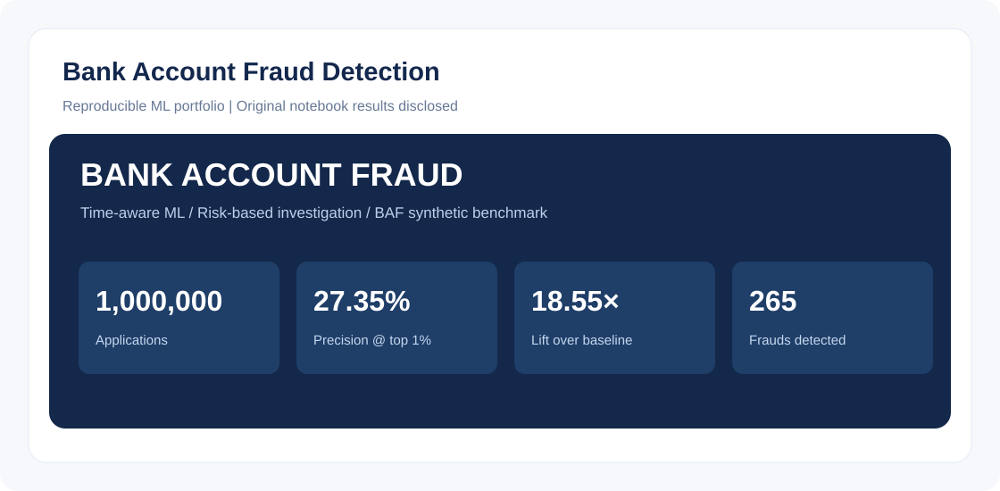
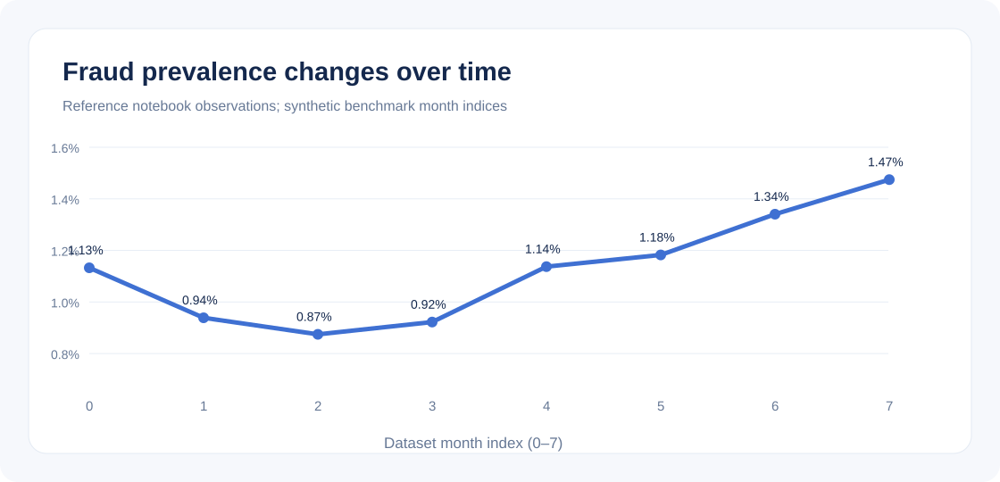
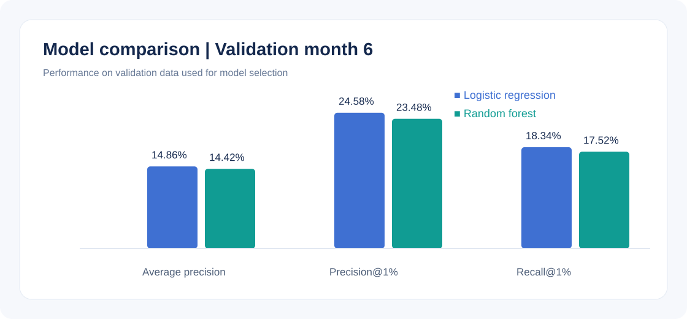
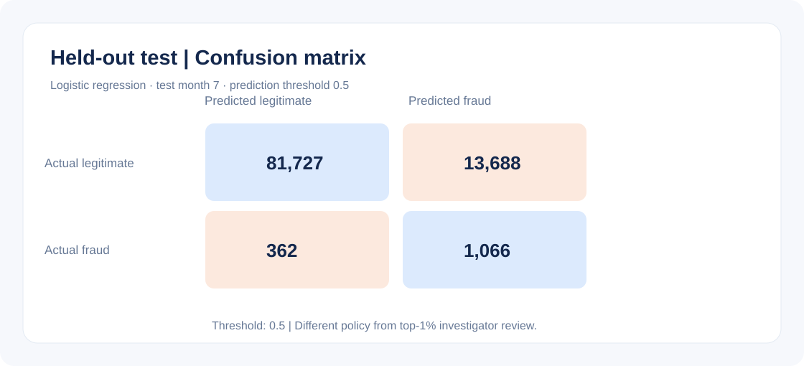

# Bank Account Fraud Detection
### Time-aware classification · Operational risk ranking · 1% review capacity

**Author:** Ilia Jakhaia  |  **Python · scikit-learn · pandas · NumPy · Matplotlib**



## Executive summary

Banks cannot manually investigate every new account application. This project benchmarks
**logistic regression** and **random forest** on the *synthetic* Bank Account Fraud (BAF)
Dataset Suite, **Base.csv** (NeurIPS 2022), then asks a business-centered question:
**If analysts can review only the riskiest 1% of applications, how much fraud can they find?**

The held-out test period covers **month index 7**; all model choices were made using
**month index 6**, after training on **months 0–5**.

> **Results provenance:** All numerical results below are transcribed from the **executed,
> user-supplied notebook**, not re-trained on the full dataset in this repository build.
> Re-running the pipeline will generate fresh metrics and plots in `results/generated/`.

| Key metric | Held-out test result |
|---|---:|
| Test applications | **96,843** |
| Test fraud prevalence | **1.475%** |
| Selected classifier | **Logistic Regression** |
| Average Precision (AP / area under precision–recall step curve) | **0.1791** |
| Analyst review capacity (top 1%) | **969 applications** |
| Fraud cases found in reviewed group | **265** |
| Precision at 1% capacity | **27.35%** |
| Recall at 1% capacity | **18.56%** |
| Enrichment over random review at test prevalence | **18.55×** |

**Interpretation:** In the original experiment, reviewing 969 of the highest-scored
applications surfaced 265 fraudulent ones. That is *ranking efficiency at a fixed budget*,
not 27% fraud recall and not a real-world savings estimate.

## What I built

- A complete exploratory analysis of class imbalance, monthly fraud prevalence, and a
  descriptive foreign-request subgroup comparison.
- **Forward-in-time data splitting** to reduce look-ahead leakage.
- Separate, scikit-learn-based preprocessing pipelines for numeric and categorical inputs.
- Two cost-sensitive classifiers: balanced logistic regression and balanced-subsample random forest.
- Proper ranking metrics for rare-event classification: **Average Precision**, **Precision@1%**,
  **Recall@1%**, and **lift** above the split-specific base rate.
- Validation-only model selection followed by a **single held-out test evaluation**.
- A reusable CLI, clean Jupyter notebook, unit tests, and GitHub Actions workflow.

## Dataset

**BAF NeurIPS 2022 / `Base.csv`**: 1,000,000 synthetic bank-account applications,
32 columns including `fraud_bool` and `month`, and **11,029 positive fraud labels**
(1.1029%). The dataset is designed for research, not for directly identifying fraud
in a real bank. The dataset is **not included** in this repository due to its size
and separate redistribution terms.

| Period | Month indices | Observations | Fraud prevalence |
|---|---|---:|---:|
| Training | 0–5 | 794,989 | 1.0253% |
| Validation | 6 | 108,168 | 1.3405% |
| Test | 7 | 96,843 | 1.4746% |

**Data acquisition:** [Kaggle dataset](https://www.kaggle.com/datasets/sgpjesus/bank-account-fraud-dataset-neurips-2022)
· [BAF authors / source repository](https://github.com/feedzai/bank-account-fraud)
· [NeurIPS publication](https://arxiv.org/abs/2211.13358).



**Observation:** Recorded prevalence rose from **0.875% (month 2)** to
**1.475% (month 7)**. Drift should be assessed before deploying a model beyond the benchmark.

## Model comparison · validation month 6



| Metric | Logistic regression | Random forest |
|---|---:|---:|
| Average Precision | **0.1486** | 0.1442 |
| Precision@1% | **24.58%** | 23.48% |
| Recall@1% | **18.34%** | 17.52% |
| Cases detected among top 1,082 | **266** | 254 |

The logistic regression model wins on **both AP and operational precision** on the
validation period. It is frozen as the selected candidate before the final test.
Neither model was tuned using the held-out test set.

## Test-set behavior



At a **0.5 probability threshold**, the selected model records **7.23% precision** and
**74.65% recall**, with 13,688 legitimate applications flagged. This operating point
is *not* the same as the **top-1%-by-score policy**, which restricts human reviews to
969 cases regardless of score magnitude. The threshold 0.5 is a reference baseline,
not a recommended production threshold.

**Precision–recall curve:** The original notebook calculated this curve from held-out prediction scores. The full score-level data are not published, so we intentionally do **not** reconstruct a curve from summary metrics. Run `baf-fraud --data data/Base.csv` to generate an evidence-backed test precision–recall curve in `results/generated/figures/test_precision_recall_curve.png`.

## Quick start

Requirements: Python **3.10+**, approximately enough RAM to train on 1 million
rows, and a locally downloaded `Base.csv` file.

```bash
# 1. Clone your repository and enter it.
python -m venv .venv
source .venv/bin/activate  # Windows: .venv\Scripts\activate
python -m pip install -e '.[dev,notebook]'

# 2. Download Base.csv from Kaggle into data/Base.csv, then:
baf-fraud --data data/Base.csv

# Alternative: let kagglehub download the public dataset (requires network):
baf-fraud --download

# 3. Unit tests (no large dataset required)
pytest -q
```

The command prints validation metrics, chooses a model **without inspecting test results**,
then writes `results/generated/metrics.json` and five evidence-backed figures.
Open `notebooks/01_end_to_end_fraud_detection.ipynb` from the repository root for
an interactive walkthrough.

## Repository layout

```text
assets/                       Redesigned SVG figures from recorded results
src/baf_fraud/                Data loading, preprocessing, models, metrics, plots, CLI
notebooks/01_end_to_end_fraud_detection.ipynb
results/reference_notebook_results.json   Original recorded outputs (provenance stated)
tests/                        Small synthetic unit tests; no real records
.github/workflows/ci.yml      CI tests on push and pull request
data/README.md                Dataset acquisition and licensing caveat
```

## Research and deployment limitations

1. **Benchmark data are synthetic.** Real financial loss, alert cost, generalization,
   and operational impact cannot be inferred from these metrics.
2. **Encoded sentinels:** In BAF, some `-1` values encode missing or not-applicable
   states; `df.isna().sum() == 0` does *not* mean all features are substantively complete.
3. **Potential fairness effects:** Applicant attributes such as age and income may
   create unequal error rates. No fairness audit was completed in the supplied notebook.
4. **Temporal robustness:** A single held-out month does not prove long-term stability.
5. **Calibration and cost modeling:** Model scores are not guaranteed to be calibrated
   event probabilities, especially with class weighting. Review budget is a simplifying
   assumption; no analyst-hour, loss or economic optimization was measured.
6. **Reproducibility:** Exact model results can vary with library versions and platform;
   reference values are historical notebook outputs, not verification of a current run.

### Suggested next experiments

- Compare **calibrated** probabilities on a separate temporal calibration window.
- Add **group-level precision, recall, and false-positive rate** auditing, with
  privacy and fairness safeguards.
- Evaluate budget sensitivity at **0.25%, 0.5%, 1%, 2% and 5%** and confidence intervals.
- Use rolling-origin temporal validation and assess feature drift.
- Compare boosting models and investigate interpretable risk signals using SHAP
  only after establishing a stable validation protocol.

## Acknowledgments and citation

This is an **independent student portfolio analysis** using the BAF benchmark by
**Jesus et al. (NeurIPS 2022)**. Cite the [original BAF publication](https://arxiv.org/abs/2211.13358)
when reusing this project. Code in this repository is MIT-licensed; the **dataset
is governed by its own separate terms**.