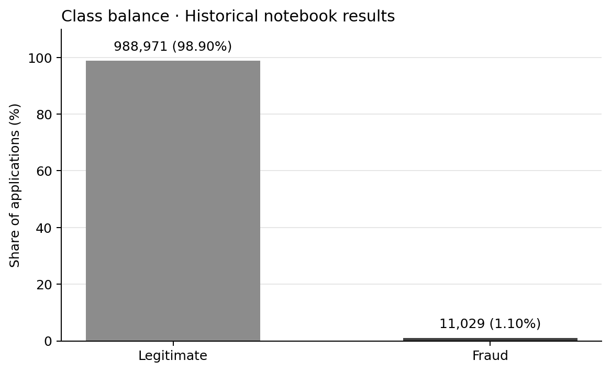
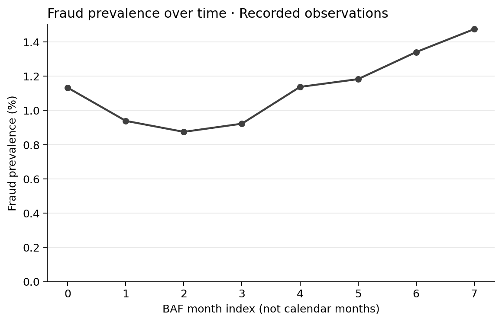
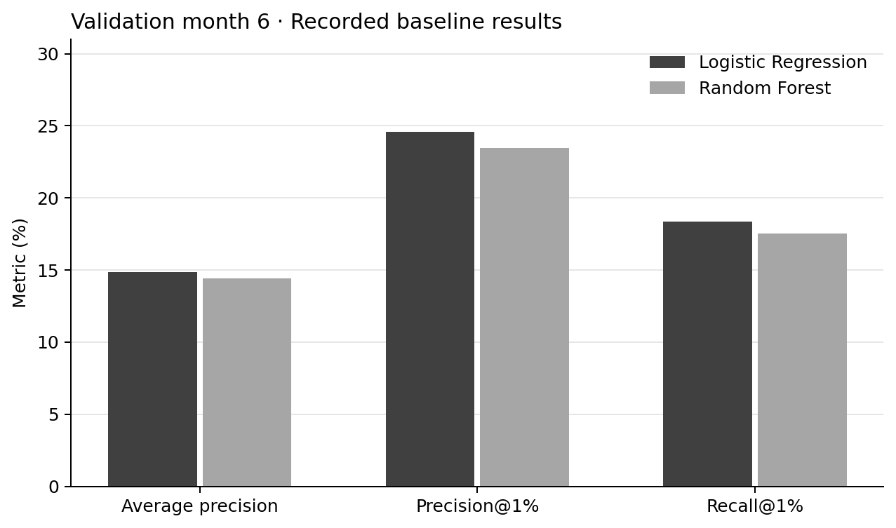
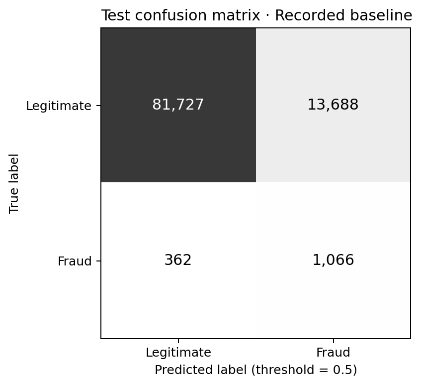
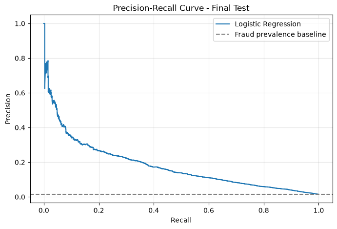

# Bank Account Fraud Detection

**Time-aware classification, rare-event evaluation, and investigation-budget analysis**

**Ilia Jakhaia** · Python · pandas · scikit-learn · Matplotlib · pytest

## Project question

When bank investigators can review **only 1% of new account applications**, how many fraudulent applications can a ranking model prioritize? This project uses the **synthetic Bank Account Fraud (BAF) Dataset Suite, Base.csv** (NeurIPS 2022) to compare logistic regression and random forest under a chronological holdout and an explicit investigation budget.

The latest code also includes a **documented, validation-only missingness and regularization experiment**, rather than stopping at two unmodified baselines.

> **Evidence status.** The baseline numbers below come from an **executed notebook supplied by the project author**. They were *not* recalculated when this repository was prepared. The extended experiment (missing-value indicators, C sweep, and budget sweep) is implemented and unit-tested, but **has not been run on the full benchmark dataset**. Its performance is unknown until the command below is executed with `Base.csv`. The figures in this README are rendered from the historical results JSON, not invented model predictions.

## Recorded baseline results

| Measure | Held-out month 7 |
|---|---:|
| Applications evaluated | 96,843 |
| Fraud cases in test split | 1,428 |
| Model chosen on validation month 6 | Logistic Regression |
| Average precision (AP) | **0.1791** |
| Applications investigated (top 1%) | **969** |
| Confirmed frauds among reviewed cases | **265** |
| Precision@1% | **27.35%** |
| Recall@1% | **18.56%** |
| Lift over test prevalence | **18.55×** |

At a **fixed review capacity**, 265 of 969 top-ranked applications were fraudulent. That is an operational ranking result from the reference run, **not** a 27% overall recall rate and **not** a claim of real-world financial savings. The separate threshold-0.5 results are 7.23% precision and 74.65% recall; they are *not* the top-1% operating point.

## Data understanding

The source dataset contains **1,000,000 synthetic applications**, **11,029 fraud labels** (1.1029%), and the indexed months `0` through `7`.



The benchmark is highly imbalanced, making raw classification accuracy a misleading sole metric. Fraud prevalence also varies by dataset month, so random train–test splitting would be a poor stand-in for a forward-looking evaluation.



### Chronological experimental design

| Partition | Month indices | Applications | Recorded fraud rate | Purpose |
|---|---|---:|---:|---|
| Training | 0–5 | 794,989 | 1.0253% | Fit models and preprocessing |
| Validation | 6 | 108,168 | 1.3405% | Compare candidates; select once |
| Test | 7 | 96,843 | 1.4746% | Report one final selected model |

The `fraud_bool` target and `month` are excluded from predictors. Preprocessing lives **inside each scikit-learn pipeline**, so imputation, encoding and scaling parameters are learned from training data alone.

## Baselines: validation comparison



| Validation metric | Logistic Regression | Random Forest |
|---|---:|---:|
| Average precision | **0.1486** | 0.1442 |
| Precision@1% | **24.58%** | 23.48% |
| Recall@1% | **18.34%** | 17.52% |
| Fraudulent applications in top 1% | **266** | 254 |

**Historical selection:** Logistic regression ranked higher on validation AP and Precision@1%. Its recorded test confusion matrix at the *different*, fixed 0.5 threshold is shown below.



The following precision–recall curve was extracted from the original executed notebook. Unlike the summary plots above, its shape depends on individual model scores, so it was **not** synthesized from aggregate metrics.



## What changed beyond the baselines

The new experiment tests a specific feature-engineering hypothesis without peeking at month 7:

1. **Targeted sentinel handling:** For five documented candidate fields, replace *exactly* `-1` with missing and add a missingness indicator. Other negatives, including legitimate negative credit-risk scores or transfer amounts, are preserved.
2. **Small regularization sweep:** Compare sentinel-aware logistic regression at `C=0.3` and `C=1.0` against the original logistic regression and random forest baselines. Choose using **validation AP**, then validation precision at the specified review budget in a tie.
3. **Investigation capacity sensitivity:** For the chosen candidate, report Precision@k, Recall@k, fraud counts, and lift for **0.25%, 0.5%, 1%, 2%, and 5%** review capacity. The budget curves are generated from *actual predictions* when the experiment runs.
4. **Final holdout:** Evaluate the selected candidate once on month 7, after all settings have been chosen from month 6.

**Important:** These are implemented experimental procedures, **not established accuracy improvements**. The final model, test metrics and new charts remain unknown until execution on `Base.csv`. See [Experiment protocol](docs/EXPERIMENT_PROTOCOL.md).

## Reproduce the complete experiment

**Requirements:** Python 3.10+ and the official `Base.csv` dataset. Training several models on ~1M rows may take substantial time and memory.

```bash
git clone https://github.com/IliaJakha/bank-account-fraud-risk-scoring.git
cd bank-account-fraud-risk-scoring
python -m venv .venv
source .venv/bin/activate  # On Windows: .venv\Scripts\activate
python -m pip install -e '.[dev,notebook]'
```

Download `Base.csv` from the [BAF Kaggle mirror](https://www.kaggle.com/datasets/sgpjesus/bank-account-fraud-dataset-neurips-2022) into `data/Base.csv` (excluded from version control), then run:

```bash
baf-fraud --data data/Base.csv
```

Or use `baf-fraud --download` with an internet connection. The run generates genuine evidence artifacts under:

```text
results/generated/metrics.json
results/generated/figures/class_imbalance.png
results/generated/figures/monthly_fraud_rate.png
results/generated/figures/validation_model_comparison.png
results/generated/figures/validation_budget_sweep.png
results/generated/figures/test_budget_sweep.png
results/generated/figures/test_precision_recall_curve.png
results/generated/figures/test_confusion_matrix.png
```

**Before publishing newly measured numbers**, check `metrics.json` for the selected candidate and full-run provenance. Replace the reference tables and figures only with those *actual outputs*, identifying them as a new experiment; never silently overwrite the historical benchmark results. The notebook at [`notebooks/01_end_to_end_fraud_detection.ipynb`](notebooks/01_end_to_end_fraud_detection.ipynb) runs the same pipeline interactively. Its execution outputs are intentionally left blank until a real `Base.csv` run is available.

For a quick quality check *without* the full dataset:

```bash
python -m ruff check .
python -m pytest -q
python scripts/render_reference_figures.py
```

The reference plots can be regenerated from [`results/reference_notebook_results.json`](results/reference_notebook_results.json). Their provenance is explicitly recorded in that file.

## Repository map

```text
assets/                             Plain Matplotlib plots from historical notebook metrics
scripts/render_reference_figures.py Reproduce historical descriptive figures
src/baf_fraud/                      Clean loading, preprocessing, models, metrics, plots and CLI
notebooks/01_end_to_end_fraud_detection.ipynb  Interactive experiment (run requires Base.csv)
results/reference_notebook_results.json        Historical notebook metrics with provenance
results/generated/                  New experiment outputs after actual local execution
data/README.md              Dataset acquisition and sentinel caveats
tests/                              Unit + synthetic smoke tests
.github/workflows/ci.yml            Ruff lint and pytest on pushes and PRs
```

## Limitations and responsible use

- **Synthetic benchmark:** Predictive ranking here cannot establish performance in a real bank or quantify losses prevented.
- **Fairness:** Applicant-related proxies may be associated with unequal outcomes; this project does not certify fairness or suitability for automated account decisions.
- **Drift:** One chronologically held-out test month cannot establish long-term performance.
- **Calibration:** Class-weighted model outputs are not guaranteed to be calibrated fraud probabilities.
- **Sentinel semantics:** The specific `-1` interpretations are a feature-engineering hypothesis that must be validated on the official benchmark and across data variants.
- **Review capacity:** Investigation costs and false-positive harms were not measured; the selected fractions illustrate staffing constraints.

## Dataset credit

Based on the [Bank Account Fraud Dataset Suite](https://github.com/feedzai/bank-account-fraud) by Jesus et al., NeurIPS 2022 ([publication](https://arxiv.org/abs/2211.13358)). This is an independent educational project. Code is MIT-licensed; **data remain subject to their own terms**.
