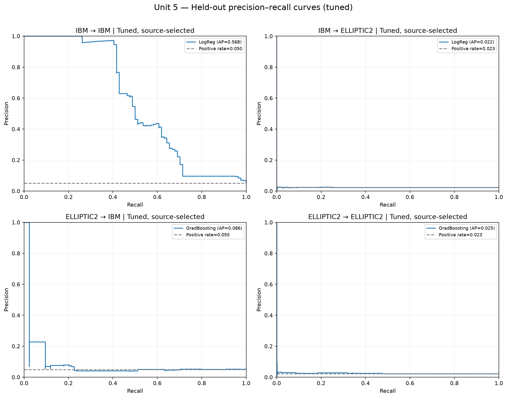
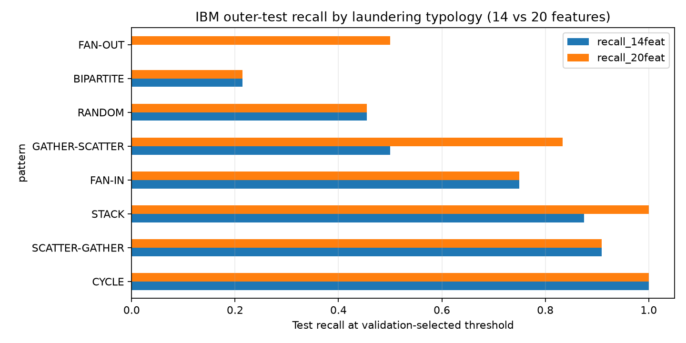
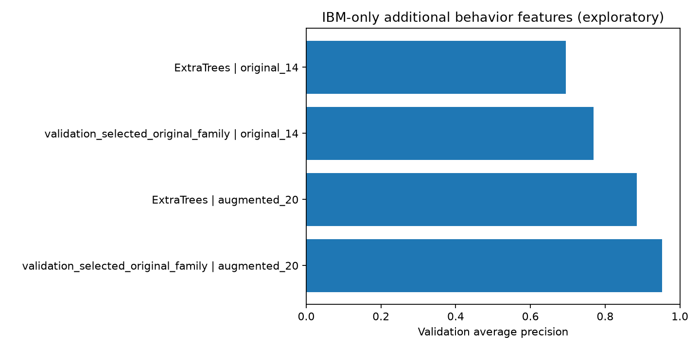
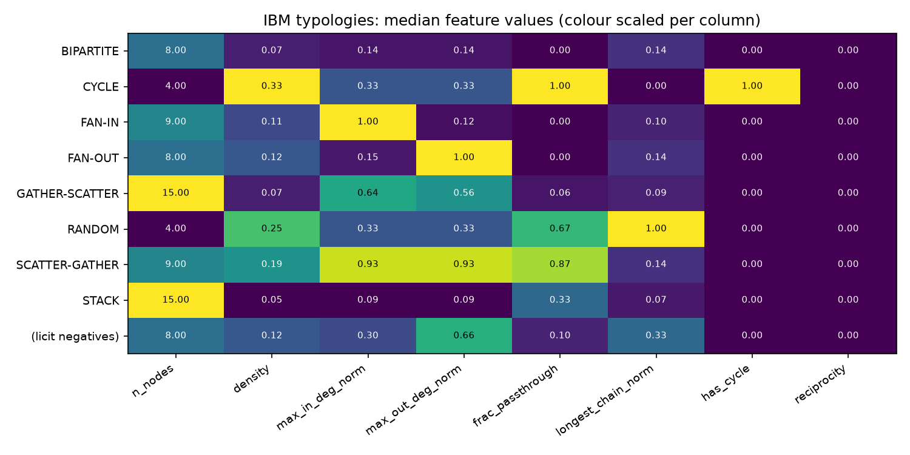

# Structural Graph Features for Anti-Money-Laundering Detection — IBM AML HI-Small vs Elliptic2

[](https://github.com/IliaJakha/bank-account-fraud-risk-scoring/actions/workflows/ci.yml)

An end-to-end comparative study evaluating whether 14 interpretable directed-graph topological features can distinguish suspicious from licit transaction subgraphs within synthetic banking data (**IBM AML HI-Small**) and whether models trained in one domain transfer to real-world Bitcoin cluster components (**Elliptic2**).

## Research Question

> Can structural features of directed transaction subgraphs distinguish suspicious from licit activity, and does a model trained on synthetic bank transfers (IBM AML HI-Small) transfer to real cryptocurrency cluster graphs (Elliptic2)?

---

## Quickstart

```bash
git clone https://github.com/IliaJakha/bank-account-fraud-risk-scoring.git
cd bank-account-fraud-risk-scoring
python -m venv .venv && source .venv/bin/activate
pip install -e ".[dev]"

# Run unit & fixture integration tests + Ruff linter (offline, ~10s)
make lint
make test

# Full end-to-end pipeline (~500 MB auto-download on first run, SHA-256 verified)
make data         # Download & verify pinned Hugging Face dataset files
make features     # Build IBM (7,770) & Elliptic2 (121,810) subgraph feature tables
make experiments  # Run 3-seed benchmark, Unit 4/5 tuning & calibration, Extensions 1-12
make report       # Regenerate evaluation and domain-shift figures from CSVs
```

You can also invoke the CLI directly via `python -m aml_graph {data,features,experiments,report,test} --config-dir configs --output-dir outputs`.

### Run with Docker

```bash
# Build reproducible container image
docker build -t aml-graph:latest .

# Run offline linter & pytest suite inside the container
docker run --rm aml-graph:latest test

# Run full pipeline with mounted host data/ and outputs/ directories
mkdir -p data outputs
docker run --rm -v "$(pwd)/data:/app/data" -v "$(pwd)/outputs:/app/outputs" aml-graph:latest data
docker run --rm -v "$(pwd)/data:/app/data" -v "$(pwd)/outputs:/app/outputs" aml-graph:latest features
docker run --rm -v "$(pwd)/data:/app/data" -v "$(pwd)/outputs:/app/outputs" aml-graph:latest experiments
docker run --rm -v "$(pwd)/data:/app/data" -v "$(pwd)/outputs:/app/outputs" aml-graph:latest report
```

---

## Key Results

### 1. Within-Domain Performance (`IBM → IBM`, 14 Structural Features, Outer Test *n* = 1,686, prevalence = 0.0498)

| Model | Test AP | 95% Bootstrap CI | ROC-AUC | F1 | Brier (Raw → Calibrated) |
|---|---:|---:|---:|---:|---:|
| **GradBoosting** | **0.6218** | 0.5227–0.7199 | **0.8884** | **0.6116** | 0.0990 → 0.0257 |
| **ExtraTrees** | 0.5798 | 0.4769–0.6874 | 0.8849 | 0.5638 (0.5733 cal.) | 0.1026 → 0.0313 |
| **LogReg** *(val-selected)* | 0.5677 | 0.4643–0.6677 | 0.8769 | 0.4848 | 0.1159 → 0.0315 |
| **RandomForest** | 0.5638 | 0.4581–0.6712 | 0.8751 | 0.5638 | 0.0880 → 0.0290 |

- **Beyond graph size:** The archival 3-seed `SizeOnly` baseline (`n_nodes`, `n_edges`) reaches only AP `0.253` (F1 `0.365`), and `topology_excluding_size` (12 features) achieves test AP `0.5657` vs `0.5677` for all 14 features (`LogReg`), confirming genuine structural signal.
- **Calibration vs ranking:** Within IBM, validation hyperparameter tuning changed outer-test AP by less than `±0.015` relative to defaults (within the 95% CIs; cross-domain `Elliptic2 → IBM` `GradBoosting` rose from `0.0432` to `0.0863`, still weak), while validation-only Platt calibration reduced IBM test Brier scores from `0.088–0.116` down to `0.026–0.032` without altering ranking.

### 2. Cross-Domain & Elliptic2 Results (14 Structural Features)

- **Elliptic2 → Elliptic2** (*n* = 36,543, prevalence = 0.0227): Tuned AP `0.0238–0.0256` (1.05–1.13× lift; ROC-AUC `0.5168–0.5313`) — near random with these 14 features.
- **IBM → Elliptic2** (*n* = 36,543, prevalence = 0.0227): Tuned AP `0.0223–0.0234` (0.99–1.03× lift; ROC-AUC `0.4919–0.5092`) — no zero-shot transfer.
- **Elliptic2 → IBM** (*n* = 1,686, prevalence = 0.0498): Tuned AP `0.0429–0.1105` (ROC-AUC `0.3440–0.4806`) — fails to transfer.
- **Domain-shift diagnosis (train partitions):** Large Kolmogorov–Smirnov gaps exist in `deg_gini` (KS `0.595`), `longest_chain_norm` (KS `0.577`), `density` (KS `0.486`), `n_nodes` (KS `0.484`), and `n_edges` (KS `0.476`).

### 3. Robustness & Extension Findings

- **Common-BFS sensitivity (2,500 candidates):** When both classes are constructed via the same label-blind BFS algorithm (`1,500` train / `437` val / `382` test; test prevalence `0.6623`), `GradBoosting` achieves test AP `0.7258` (ROC-AUC `0.6061`, F1 `0.8006`) vs `SizeOnly` AP `0.6499` (ROC-AUC `0.4782`). Structural models beat size alone, though lift over prevalence is modest (`1.10×`), confirming that part of the main benchmark's separation stems from positive vs negative construction differences.
- **Account-disjoint retrain:** Enforcing zero shared accounts across `fit` (`6,877`), `val` (`437`), and `test` (`365`, 6 positives) yields test AP `0.6735`, ROC-AUC `0.7611`, and F1 `0.8000` (`LogReg`), showing signal persists without recurring accounts, albeit with weaker ranking than the main split (`ROC-AUC 0.877`).
- **IBM-only transaction-activity features (20 features):** Adding six label-free behavioral features (`n_transactions`, `transactions_per_hour`, `repeat_pair_fraction`, `dominant_pair_fraction`, `active_span_minutes`, `median_interarrival_minutes`) raises validation-selected `LogReg` test AP from `0.5677` to **`0.8602`** (17.26× lift, ROC-AUC `0.9792`, F1 `0.7972`).
- **Typology recall (`14` → `20` features):** High recall on `CYCLE` (`1.000 → 1.000`), `SCATTER-GATHER` (`0.909 → 0.909`), and `STACK` (`0.875 → 1.000`), strong gain on `GATHER-SCATTER` (`0.500 → 0.833`) and `FAN-OUT` (`0.000 → 0.500`), and persistently low recall on `BIPARTITE` (`0.214 → 0.214`) and `RANDOM` (`0.455 → 0.455`).

---

## Key Figures

| Cross-Domain AP Lift | Held-Out Precision–Recall Curves |
|---|---|
|  |  |

| IBM vs Elliptic2 Domain Shift (KS) | Laundering Typology Recall (14 vs 20 Features) |
|---|---|
|  |  |

| IBM Activity Features Validation AP | IBM Laundering Typologies Heatmap |
|---|---|
|  |  |

---

## Method Summary

### The 14 Directed-Graph Features

Each subgraph is represented as a simple directed graph `nx.DiGraph` (self-loops removed, parallel edges collapsed):

| Feature | Definition | Category |
|---|---|---|
| `n_nodes` | Number of accounts (IBM) or clusters (Elliptic2) | Size |
| `n_edges` | Number of unique directed edges `m` | Size |
| `density` | `m / [n(n - 1)]` for `n > 1` | Connectivity |
| `edges_per_node` | `m / n` | Connectivity |
| `max_in_deg_norm` | Maximum in-degree divided by `n - 1` | Degree concentration |
| `max_out_deg_norm` | Maximum out-degree divided by `n - 1` | Degree concentration |
| `hub_share` | Largest total degree `(in + out)` divided by `2m` | Centralization |
| `deg_gini` | Gini inequality of total node degrees | Centralization |
| `frac_sources` | Fraction of nodes with `in = 0, out > 0` | Flow roles |
| `frac_sinks` | Fraction of nodes with `out = 0, in > 0` | Flow roles |
| `frac_passthrough` | Fraction of nodes with `in > 0, out > 0` | Flow roles |
| `longest_chain_norm` | Longest path in SCC condensation DAG divided by `n - 1` | Hierarchy |
| `has_cycle` | Binary indicator for nontrivial strongly connected component (`|SCC| > 1`) | Cycles |
| `reciprocity` | Fraction of directed edges with a reverse edge | Cycles |

### Splits, Overlap Purging & Validation-Only Selection

- **IBM splits:** Chronological 70/30 outer train/test split and 80/20 inner fit/validation split, purging any validation or test subgraph that shares any original transaction-row ID with earlier splits.
- **Elliptic2 splits:** Stratified 70/30 outer and 80/20 inner splits, purging any cluster ID overlap across partitions.
- **Zero test leakage:** Hyperparameter selection, Platt probability calibration (`ValidationPlattCalibrator`), and F1-maximizing operating thresholds are fitted strictly on source validation splits.

---

## Package & Repository Layout

```text
bank-account-fraud-risk-scoring/
├── .github/workflows/ci.yml             # GitHub Actions CI (Python 3.12 & 3.13, Ruff + pytest)
├── configs/
│   ├── data.yaml                        # Pinned HF commit hashes & SHA-256 checksums
│   ├── sampling.yaml                    # Legacy BFS & Common-BFS sampling parameters
│   ├── benchmark.yaml                   # 3-seed baseline configuration
│   ├── tuning.yaml                      # Unit 4/5 hyperparameter grids & Platt calibration
│   └── extensions.yaml                  # Extensions 1–12 parameters
├── src/aml_graph/
│   ├── config.py                        # YAML loading, config SHA-256 hashing & provenance JSON
│   ├── data.py                          # SHA-256 verification & raw IBM/Elliptic2 loaders
│   ├── sampling.py                      # EdgeIndex, label-blind guard & subgraph samplers
│   ├── features.py                      # 14 topological features & IBM activity features
│   ├── splits.py                        # Purged, chronological-embargo & account-disjoint splits
│   ├── models.py                        # Baseline & tuned estimators + ValidationPlattCalibrator
│   ├── evaluate.py                      # Evaluation metrics, bootstrap CIs & experiment runners
│   ├── plots.py                         # Report figure generators reading directly from CSVs
│   └── cli.py                           # CLI entrypoint (`python -m aml_graph ...`)
├── tests/
│   ├── fixtures/                        # Committed mini IBM & Elliptic2 fixture + configs for CI
│   ├── test_features.py                 # Hand-built graph topologies & Gini edge cases
│   ├── test_splits.py                   # Transaction-disjoint & account-disjoint guarantees
│   ├── test_sampling_and_data.py        # SHA-256 corruption checks & no-label-use guarantees
│   ├── test_window_leak_xfail.py        # xfail(Phase 2) test documenting legacy window asymmetry
│   └── test_cli_fixture.py              # End-to-end offline CLI pipeline integration test
├── notebooks/
│   └── legacy/                          # Archived pre-refactor 81-cell monolithic notebook
├── AML_Graph_Structure_Transfer.ipynb   # Concise presentation notebook loading saved outputs
├── outputs/
│   ├── phase1_verify/regression.csv     # Notebook vs refactored package numerical comparison
│   ├── eda_*.png / eda_*.csv            # Exploratory data analysis tables and plots
│   ├── results_raw.csv / results_summary.csv / results_lift.png
│   ├── unit4_*.csv / unit5_*.csv / unit5_*.png / unit6_*.png
│   └── research_extension/              # Extensions 1–12 tables, figures & summary JSON
├── Dockerfile
├── Makefile
├── pyproject.toml
├── requirements.txt
└── LICENSE
```

*(Large regenerable intermediates — `data/`, `outputs/subgraph_sets.pkl`, `outputs/elliptic2_features.csv`, `outputs/unit5_test_predictions.csv`, and `outputs/research_extension/ibm_activity_feature_table.csv` — are excluded via `.gitignore` and recreated on run.)*

---

## Limitations

- Positive and negative IBM subgraphs are produced by different mechanisms (documented laundering attempts vs licit BFS neighborhoods), and positive observation windows clamp `[t0, t1]` to attempt endpoints (`test_window_leak_xfail.py`).
- IBM account graphs and Elliptic2 cluster components differ in node semantics and label definitions.
- IBM is evaluated on a single chronological split, so bootstrap confidence intervals reflect test-sample uncertainty rather than cross-period temporal variance.
- Positive rates in the constructed samples (`0.0498` IBM test, `0.0227` Elliptic2 test) do not reflect real-world AML deployment base rates.
- This is an educational/research benchmark, not a production AML alerting system.

---

## Data Sources & Citations

Raw datasets are **not** redistributed in this repository and remain subject to their original licenses.

- **IBM AML HI-Small:** E. Altman, J. Blanuša, L. von Niederhäusern, B. Egressy, A. Anghel, and K. Atasu (2023), *"Realistic Synthetic Financial Transactions for Anti-Money Laundering Models"*, NeurIPS Datasets & Benchmarks. Mirror used: `https://huggingface.co/datasets/OsamaMIT/IBM-AML-HI`
- **Elliptic2:** C. Bellei, M. Xu, R. Phillips, T. Robinson, M. Weber, T. Kaler, C. E. Leiserson, Arvind, and J. Chen (2024), *"The Shape of Money Laundering: Subgraph Representation Learning on the Blockchain with the Elliptic2 Dataset"*, arXiv:2404.19109. Mirror used: `https://huggingface.co/datasets/mendozzzz/elliptic2-data-set`

---

## License & Author

- **Code License:** [MIT](LICENSE)
- **Author:** Ilia Jakhaia
