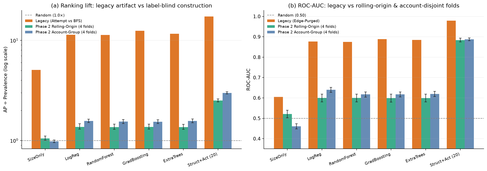
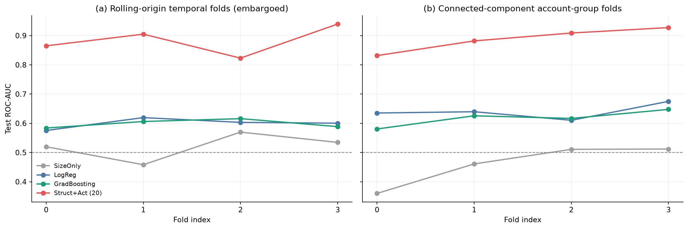
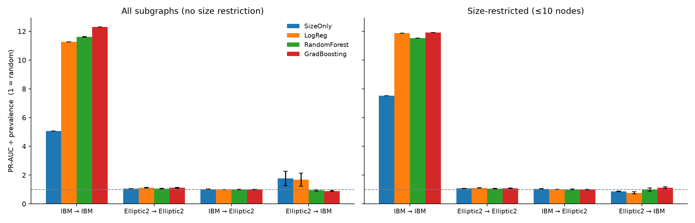
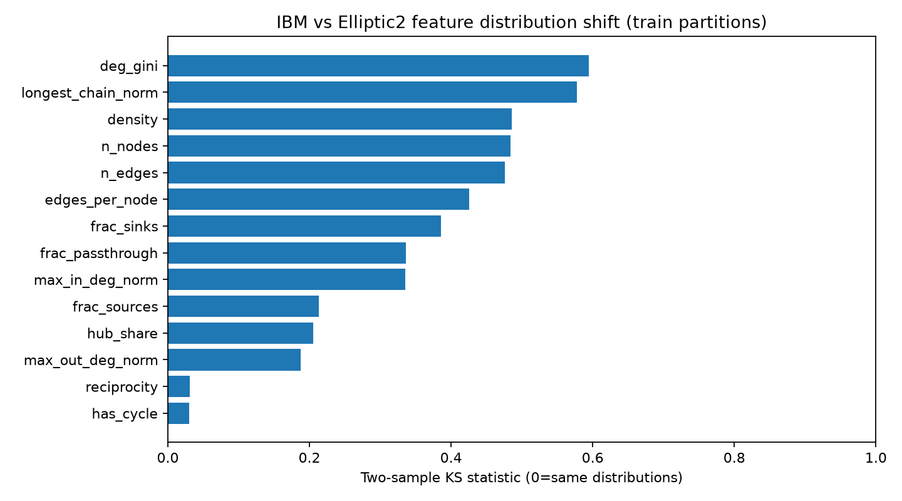

# AML Subgraph Construction Bias & Structural Graph Transfer - IBM AML HI-Small vs Elliptic2

[](https://github.com/IliaJakha/bank-account-fraud-risk-scoring/actions/workflows/ci.yml)

Empirical audit of **candidate-construction bias**, **observation-window leakage**, and **cross-domain topological transfer** in directed financial transaction subgraphs (**IBM AML HI-Small** synthetic bank transfers vs **Elliptic2** Bitcoin cluster components).

1. **Candidate-construction confound:** Replacing documented laundering attempts vs licit BFS neighborhoods with a single label-blind BFS sampler reduces validation-selected 14-feature `LogReg` from legacy AP `0.57` (`11.39×` lift, ROC-AUC `0.88`) to fold-mean AP `0.43` (`1.37×` lift, ROC-AUC `0.60`) on rolling-origin folds and AP `0.42` (`1.57×` lift, ROC-AUC `0.64`) on account-disjoint folds.
2. **Window-leak fix & surviving activity signal:** Symmetric seed-offset windows lower 20-feature ROC-AUC from `0.98` (AP `0.86`) to `0.88–0.89` (AP `0.74`), yet the 6-feature activity signal survives on strictly uniform-seeded candidates (`0.63%` natural prevalence) with account-disjoint ROC-AUC `0.85` (AP `0.12`) vs `0.69` (AP `0.02`) for 14-feature `LogReg`.
3. **Cross-domain transfer failure:** Zero-shot topological transfer from IBM AML HI-Small to Elliptic2 fails near random ranking (AP `0.02` at `2.27%` prevalence, `0.99×–1.03×` lift, ROC-AUC `0.49–0.51`), while within-Elliptic2 14-feature models reach only `1.05×–1.13×` lift under severe subgraph-size and degree-skewness shift (KS `0.58–0.60`).



---

## Before vs After: Legacy Benchmark vs Phase 2 Label-Blind Benchmark (`IBM → IBM`)

`LogReg` is marked **`(Val-Selected)`** because it achieved the highest mean inner-validation AP among all 14-feature structural models in both **Rolling-Origin** (`val AP = 0.3571`) and **Account-Group** (`val AP = 0.4258`) regimes. All Phase 2 uncertainty intervals below are **fold-stratified percentile bootstrap 95% CIs clipped to valid mathematical domains** (`[0, 1]` for AP and ROC-AUC; `[0, ∞)` for lift) - never `mean ± t·sd` and never pooling raw probabilities across folds. Every fold exceeded the `>= 30` unweighted test-positive rule (`222–612` positives/fold in Rolling-Origin; `477–1,141` positives/fold in Account-Group); per-fold IPW population estimates had `< 30` Kish effective positives and are marked **`not estimable`** in the [Appendix](#appendix-inverse-probability-weighting-ipw--kish-effective-sample-size-diagnostics).

| Model | Legacy AP (95% CI) | Legacy Lift / AUC | Rolling-Origin Fold AP (95% Boot CI) | RO Lift (95% Boot CI) | RO ROC-AUC (95% Boot CI) | Account-Group Fold AP (95% Boot CI) | AG Lift (95% Boot CI) | AG ROC-AUC (95% Boot CI) |
|---|---|---|---|---|---|---|---|---|
| `SizeOnly` *(2 feat)* | `0.2526` *(n/a)* | `5.07×` / `0.6050` | `0.3401` `[0.3306, 0.3548]` | `1.05×` `[1.01, 1.11]` | `0.5206` `[0.5023, 0.5394]` | `0.2589` `[0.2528, 0.2667]` | `0.98×` `[0.96, 1.01]` | `0.4609` `[0.4483, 0.4737]` |
| **`LogReg` *(Val-Selected, 14 feat)*** | `0.5677` `[0.4643, 0.6677]` | `11.39×` / `0.8769` | **`0.4301` `[0.4126, 0.4548]`** | **`1.37×` `[1.30, 1.48]`** | **`0.5995` `[0.5800, 0.6187]`** | **`0.4155` `[0.4022, 0.4310]`** | **`1.57×` `[1.51, 1.64]`** | **`0.6400` `[0.6277, 0.6515]`** |
| `RandomForest` *(14 feat)* | `0.5638` `[0.4581, 0.6712]` | `11.32×` / `0.8751` | `0.4287` `[0.4113, 0.4524]` | `1.37×` `[1.30, 1.46]` | `0.5996` `[0.5802, 0.6185]` | `0.4026` `[0.3884, 0.4190]` | `1.55×` `[1.48, 1.62]` | `0.6172` `[0.6042, 0.6293]` |
| `GradBoosting` *(14 feat)* | `0.6218` `[0.5227, 0.7199]` | `12.48×` / `0.8884` | `0.4281` `[0.4117, 0.4497]` | `1.37×` `[1.30, 1.46]` | `0.5986` `[0.5794, 0.6184]` | `0.4014` `[0.3869, 0.4168]` | `1.54×` `[1.48, 1.61]` | `0.6176` `[0.6048, 0.6296]` |
| `ExtraTrees` *(14 feat)* | `0.5798` `[0.4769, 0.6874]` | `11.64×` / `0.8849` | `0.4283` `[0.4115, 0.4507]` | `1.36×` `[1.29, 1.45]` | `0.5994` `[0.5805, 0.6188]` | `0.4074` `[0.3932, 0.4241]` | `1.57×` `[1.51, 1.64]` | `0.6193` `[0.6064, 0.6318]` |
| `ActivityOnly_6` *(6 activity feat)* | *(n/a)* | *(n/a)* | `0.7421` `[0.7230, 0.7646]` | `2.50×` `[2.42, 2.60]` | `0.8850` `[0.8761, 0.8946]` | `0.7614` `[0.7471, 0.7755]` | `3.08×` `[3.01, 3.14]` | `0.8910` `[0.8844, 0.8977]` |
| `StructPlusActivity_20` *(20 feat)* | `0.8602` *(clamped window)* | `17.26×` / `0.9792` | `0.7434` `[0.7250, 0.7655]` | `2.51×` `[2.43, 2.61]` | `0.8831` `[0.8743, 0.8930]` | `0.7429` `[0.7282, 0.7590]` | `2.99×` `[2.92, 3.06]` | `0.8874` `[0.8806, 0.8944]` |

*(Prevalence context: Legacy IBM test prevalence is `0.0498`. Phase 2 fold-mean unweighted prevalence under `α = 0.25` seed enrichment is `0.3286` across Rolling-Origin (`N_test = 4,257`, `1,387` positives) and `0.2720` across Account-Group (`N_test = 10,000`, `2,730` positives). `SizeOnly` hovers near random (`0.5206` RO, `0.4609` AG) because target node sizes `[4, 6, 8, 10, 12]` are drawn from the same fixed distribution independent of labels.)*

---

## Seed-Mode Check: Uniform-Seeded Candidates Only (`seed_source == "uniform"`)

To verify that the intra-window activity signal is not a byproduct of positive seed enrichment (`seed_source == "positive_enriched"`), every fold-trained model was evaluated **strictly on uniform-seeded test candidates** (`seed_source == "uniform"`, including both uniform-seeded positives and uniform-seeded negatives; `outputs/phase2/uniform_seed_check.csv`).

**Does the activity signal survive? Yes.** Even when every positive-enriched seed is excluded at evaluation time so both classes originate from uniform random transaction seeds (`0.52%–0.63%` natural positive rate), **`ActivityOnly_6` and `StructPlusActivity_20` retain ROC-AUC `0.85–0.87` (`AP 0.12–0.16`) on Account-Group (`n = 7,316`, `46` positives `>= 30`) and `0.81–0.82` (`AP 0.20–0.21`) on Rolling-Origin (`n = 2,885`, `15` positives - low statistical power `< 30`)**, outperforming 14-feature `LogReg` (`ROC-AUC 0.69` / `0.61`, `AP 0.02` / `0.03`) by `+0.16` to `+0.22` ROC-AUC. Removing the legacy window-clamping leak (`88.11%` clamped positives → `0.37%` under symmetric windows) eliminates the artificial `0.98–1.00` ceiling, while IBM's synthetic laundering burstiness and multi-edge velocity still separate uniform-seeded positives from background traffic - though absolute AP drops sharply (`0.74–0.76` → `0.12–0.21`) at the `~0.6%` natural base rate.

| Regime (`seed_source == "uniform"` only) | Uniform `n` (`pos` / `neg`, prev) | Model | Fold-Mean AP (Clipped 95% Boot CI) | Fold-Mean ROC-AUC (Clipped 95% Boot CI) | Power Note |
|---|---|---|---|---|---|
| **Account-Group** *(4 folds)* | `7,316` (`46` / `7,270`, `0.0063`) | `SizeOnly` *(2 feat)* | `0.0103` `[0.0080, 0.0162]` | `0.4969` `[0.4029, 0.5883]` | `>= 30` regime pos |
| **Account-Group** *(4 folds)* | `7,316` (`46` / `7,270`, `0.0063`) | **`LogReg` *(Val-Selected, 14 feat)*** | **`0.0213` `[0.0148, 0.0472]`** | **`0.6932` `[0.6211, 0.7726]`** | `>= 30` regime pos |
| **Account-Group** *(4 folds)* | `7,316` (`46` / `7,270`, `0.0063`) | `GradBoosting` *(14 feat)* | `0.0343` `[0.0203, 0.0888]` | `0.6525` `[0.5683, 0.7368]` | `>= 30` regime pos |
| **Account-Group** *(4 folds)* | `7,316` (`46` / `7,270`, `0.0063`) | **`ActivityOnly_6` *(6 activity feat)*** | **`0.1221` `[0.0753, 0.2381]`** | **`0.8510` `[0.8029, 0.8942]`** | `>= 30` regime pos |
| **Account-Group** *(4 folds)* | `7,316` (`46` / `7,270`, `0.0063`) | **`StructPlusActivity_20` *(20 feat)*** | **`0.1558` `[0.0854, 0.2772]`** | **`0.8659` `[0.8284, 0.9030]`** | `>= 30` regime pos |
| **Rolling-Origin** *(4 folds)* | `2,885` (`15` / `2,870`, `0.0052`) | `SizeOnly` *(2 feat)* | `0.0146` `[0.0098, 0.0454]` | `0.6460` `[0.4957, 0.7952]` | Low power (`15 < 30` pos) |
| **Rolling-Origin** *(4 folds)* | `2,885` (`15` / `2,870`, `0.0052`) | **`LogReg` *(Val-Selected, 14 feat)*** | **`0.0348` `[0.0146, 0.0906]`** | **`0.6068` `[0.4928, 0.7175]`** | Low power (`15 < 30` pos) |
| **Rolling-Origin** *(4 folds)* | `2,885` (`15` / `2,870`, `0.0052`) | `GradBoosting` *(14 feat)* | `0.0361` `[0.0144, 0.0946]` | `0.6143` `[0.4809, 0.7424]` | Low power (`15 < 30` pos) |
| **Rolling-Origin** *(4 folds)* | `2,885` (`15` / `2,870`, `0.0052`) | **`ActivityOnly_6` *(6 activity feat)*** | **`0.1961` `[0.0921, 0.3691]`** | **`0.8235` `[0.7515, 0.8855]`** | Low power (`15 < 30` pos) |
| **Rolling-Origin** *(4 folds)* | `2,885` (`15` / `2,870`, `0.0052`) | **`StructPlusActivity_20` *(20 feat)*** | **`0.2104` `[0.1036, 0.3787]`** | **`0.8061` `[0.7352, 0.8797]`** | Low power (`15 < 30` pos) |

*(Full 7-model uniform-seed summaries and per-fold tables are saved in `outputs/phase2/uniform_seed_check.csv` and `outputs/phase2/uniform_seed_check_by_fold.csv`.)*

---

## Fold-Stratified Paired Model Comparisons

### Why Cross-Fold Raw Probability Pooling Was Invalid
In IBM `HI-Small_Trans.csv`, licit background transactions end on `2022-09-10` while multi-day laundering attempts continue through `2022-09-18`. Consequently, **Rolling-Origin Fold 3 has test positive prevalence `0.60` (`0.5948`) compared to `0.21–0.26` (`0.2098–0.2617`) in Folds 0–2**. Because each fold's Platt calibrator is fitted strictly on its preceding validation window (which has lower prevalence prior to the tail shift), calibrated probability scales differ systematically across folds. Pooling raw out-of-fold probabilities across folds induces **Simpson's paradox in global ranking** - negatives from one calibration regime outscore positives from another, artificially dragging pooled ROC-AUCs below `0.50` even when every single fold achieves `ROC-AUC ≈ 0.58–0.62`.

All paired comparisons (`outputs/phase2/paired_comparisons.csv` and `outputs/phase2/paired_comparisons_by_fold.csv`) therefore compute $\Delta\text{AP}_k$ and DeLong $\Delta\text{AUC}_k$ **strictly within each fold $k$** and combine across independent folds via fold-stratified paired bootstrap (`1,000` resamples) and stratified DeLong $Z = \overline{\Delta\text{AUC}} / \sqrt{\sum_k \text{Var}(\Delta\text{AUC}_k) / K^2}$.

| Regime | Comparison (`A` vs `B`) | Combined $\Delta\text{AP}$ (95% CI, $p$) | Per-Fold $\Delta\text{AP}$ `(F0, F1, F2, F3)` | Combined $\Delta\text{AUC}$ (95% CI, DeLong $p$) | Per-Fold $\Delta\text{AUC}$ `(F0, F1, F2, F3)` |
|---|---|---|---|---|---|
| **Rolling-Origin** | `LogReg` vs `SizeOnly` | `+0.0901` `[+0.0690, +0.1124]` (`p=0.001`) | `(+0.0860, +0.1352, +0.0585, +0.0806)` | `+0.0789` `[+0.0525, +0.1048]` (`p=8.6e-10`) | `(+0.0556, +0.1611, +0.0334, +0.0656)` |
| **Rolling-Origin** | `RandomForest` vs `LogReg` | `-0.0015` `[-0.0125, +0.0071]` (`p=0.702`) | `(-0.0026, -0.0026, -0.0016, +0.0010)` | `+0.0001` `[-0.0114, +0.0110]` (`p=0.990`) | `(+0.0134, -0.0141, +0.0070, -0.0060)` |
| **Rolling-Origin** | `GradBoosting` vs `LogReg` | `-0.0020` `[-0.0146, +0.0090]` (`p=0.708`) | `(-0.0056, -0.0071, +0.0089, -0.0041)` | `-0.0010` `[-0.0135, +0.0102]` (`p=0.875`) | `(+0.0085, -0.0133, +0.0127, -0.0117)` |
| **Rolling-Origin** | `ExtraTrees` vs `LogReg` | `-0.0018` `[-0.0121, +0.0069]` (`p=0.634`) | `(-0.0048, -0.0027, -0.0012, +0.0014)` | `-0.0001` `[-0.0116, +0.0107]` (`p=0.979`) | `(+0.0066, -0.0109, +0.0104, -0.0067)` |
| **Rolling-Origin** | `ActivityOnly_6` vs `LogReg` | `+0.3120` `[+0.2848, +0.3382]` (`p=0.001`) | `(+0.3406, +0.3726, +0.2631, +0.2716)` | `+0.2854` `[+0.2659, +0.3045]` (`p<1e-100`) | `(+0.2962, +0.2816, +0.2213, +0.3426)` |
| **Rolling-Origin** | `StructPlusActivity_20` vs `LogReg` | `+0.3133` `[+0.2866, +0.3355]` (`p=0.001`) | `(+0.3363, +0.3793, +0.2709, +0.2665)` | `+0.2836` `[+0.2665, +0.3007]` (`p<1e-100`) | `(+0.2896, +0.2855, +0.2199, +0.3393)` |
| **Account-Group** | `LogReg` vs `SizeOnly` | `+0.1566` `[+0.1422, +0.1722]` (`p=0.001`) | `(+0.2271, +0.1458, +0.0936, +0.1598)` | `+0.1791` `[+0.1620, +0.1966]` (`p=3.0e-87`) | `(+0.2751, +0.1786, +0.0995, +0.1630)` |
| **Account-Group** | `RandomForest` vs `LogReg` | `-0.0129` `[-0.0224, -0.0038]` (`p=0.006`) | `(-0.0589, +0.0082, +0.0054, -0.0063)` | `-0.0228` `[-0.0308, -0.0147]` (`p=5.2e-08`) | `(-0.0495, -0.0184, +0.0056, -0.0287)` |
| **Account-Group** | `GradBoosting` vs `LogReg` | `-0.0141` `[-0.0234, -0.0048]` (`p=0.006`) | `(-0.0652, +0.0091, +0.0020, -0.0024)` | `-0.0224` `[-0.0302, -0.0142]` (`p=6.2e-08`) | `(-0.0546, -0.0139, +0.0064, -0.0274)` |
| **Account-Group** | `ExtraTrees` vs `LogReg` | `-0.0081` `[-0.0172, +0.0007]` (`p=0.088`) | `(-0.0622, +0.0173, +0.0103, +0.0024)` | `-0.0207` `[-0.0284, -0.0130]` (`p=1.9e-07`) | `(-0.0551, -0.0121, +0.0067, -0.0224)` |
| **Account-Group** | `ActivityOnly_6` vs `LogReg` | `+0.3459` `[+0.3265, +0.3634]` (`p=0.001`) | `(+0.2049, +0.3950, +0.4155, +0.3682)` | `+0.2510` `[+0.2382, +0.2626]` (`p<1e-100`) | `(+0.1841, +0.2698, +0.3047, +0.2454)` |
| **Account-Group** | `StructPlusActivity_20` vs `LogReg` | `+0.3274` `[+0.3086, +0.3444]` (`p=0.001`) | `(+0.2194, +0.2983, +0.4139, +0.3779)` | `+0.2474` `[+0.2356, +0.2590]` (`p<1e-100`) | `(+0.1964, +0.2423, +0.2986, +0.2524)` |

---

## Diagnostic Visualizations

| Window-Leak Audit & Uniform Seed-Mode Check | Rolling-Origin vs Account-Group Multi-Fold Stability |
|---|---|
|  |  |

| Cross-Domain Legacy Lift (`IBM ↔ Elliptic2`) | IBM vs Elliptic2 Domain Shift (KS Statistics) |
|---|---|
|  |  |

---

## Quickstart

```bash
git clone https://github.com/IliaJakha/bank-account-fraud-risk-scoring.git
cd bank-account-fraud-risk-scoring
python -m venv .venv && source .venv/bin/activate
pip install -e ".[dev]"

# Offline Ruff lint & 21-test pytest suite (~22s, runs on committed tests/fixtures/)
make lint
make test

# Full end-to-end pipeline (~500 MB auto-download on first run, SHA-256 verified)
make data         # Download & verify pinned Hugging Face dataset files
make features     # Build legacy IBM (7,770) & Elliptic2 (121,810) feature tables
make experiments  # Run legacy benchmark, Unit 4/5 tuning, Extensions 1-12 & Phase 2
make phase2       # Run Phase 2 label-blind methodology, seed check & figures standalone
make report       # Regenerate all evaluation & Phase 2 figures from saved CSVs
```

### Run with Docker

```bash
docker build -t aml-graph:latest .
docker run --rm aml-graph:latest test

mkdir -p data outputs
docker run --rm -v "$(pwd)/data:/app/data" -v "$(pwd)/outputs:/app/outputs" aml-graph:latest phase2
```

---

## Methodological & Engineering Notes

- **Unified Label-Blind Candidate Sampler (`src/aml_graph/sampling.py`):** Builds `10,000` IBM candidates via `common_bfs_candidate` on `idx.label_blind_view()` (`LabelAccessForbiddenError` blocks any access to `is_laundering` during graph traversal), drawing target node counts (`[4, 6, 8, 10, 12]`) and symmetric seed-offset windows (`[120, 240, 480]` min) independently of labels before post-hoc labeling and typology overlap matching.
- **Leakage-Free Splits (`src/aml_graph/splits.py`):** **Rolling-origin** uses 4 expanding temporal windows with `480`-minute (`8`-hour = maximum window duration) embargo gaps and transaction-ID purging; **Account-group** partitions all `5,672` connected components of the shared-account/shared-transaction graph across 4 folds with zero shared accounts and 100% candidate retention.
- **Phase 1 Refactor Regression Check (`outputs/phase1_verify/regression.csv`):** Across `1,340` legacy comparisons, deterministic models (`SizeOnly`, `LogReg`, `GradBoosting`) match the archived pre-refactor notebook within `4.81e-08` (`< 1e-6`); 31 thresholded `RandomForest`/`ExtraTrees` rows differ slightly (up to `0.0667` recall/F1 while `pr_auc` and `roc_auc` match `< 1e-6`) because `n_jobs=-1` aggregates parallel tree probabilities in non-deterministic floating-point thread order across tied 3-node Elliptic2 topologies.

---

## Package & Repository Layout

```text
bank-account-fraud-risk-scoring/
├── .github/workflows/ci.yml             # GitHub Actions CI (Python 3.12 & 3.13, Ruff + pytest)
├── configs/
│   ├── data.yaml                        # Pinned HF commit hashes & SHA-256 checksums
│   ├── sampling.yaml / benchmark.yaml   # Legacy benchmark configurations
│   ├── tuning.yaml / extensions.yaml    # Hyperparameter grids & extensions
│   └── phase2.yaml                      # Phase 2 sampler, splits, Kish guard & bootstrap config
├── src/aml_graph/
│   ├── config.py / data.py              # Provenance logging, SHA-256 checks & raw loaders
│   ├── sampling.py                      # Label-blind BFS, symmetric windows & Horvitz-Thompson weights
│   ├── features.py                      # 14 topological features & 6 IBM activity features
│   ├── splits.py                        # Purged, rolling-origin embargo & account-component splits
│   ├── models.py / evaluate.py          # Estimators, Platt calibration & legacy runners
│   ├── phase2.py                        # Fold-stratified bootstrap/DeLong, Kish IPW & uniform seed check
│   ├── plots.py                         # Legacy + Phase 2 visualization generators
│   └── cli.py                           # CLI (`python -m aml_graph {data,features,experiments,phase2,report,test}`)
├── tests/
│   ├── fixtures/                        # Committed mini IBM & Elliptic2 fixture + configs for CI
│   ├── test_features.py / test_splits.py / test_sampling_and_data.py
│   ├── test_window_leak_xfail.py        # Passing test verifying symmetric window placement
│   ├── test_phase2.py                   # Kish n_eff guard, clipped CIs & fold-stratified tests
│   └── test_cli_fixture.py              # Offline end-to-end CLI pipeline integration test
├── notebooks/legacy/                    # Archived pre-refactor 81-cell monolithic notebook
├── AML_Graph_Structure_Transfer.ipynb   # Concise presentation notebook loading saved outputs
├── outputs/
│   ├── phase1_verify/regression.csv     # 1,340-row notebook-vs-package regression audit
│   ├── phase2/                          # Phase 2 CSVs (`before_after_comparison.csv`, etc.) & PNGs
│   └── research_extension/              # Domain-shift, ablation & typology CSVs/PNGs
├── Dockerfile
├── Makefile
├── pyproject.toml
└── LICENSE
```

---

## Limitations & Data Citations

- **Limitations:** (1) IBM `HI-Small_Trans.csv` terminates licit background transfers after `2022-09-10`, creating the Fold 3 prevalence shift (`0.60` vs `0.21–0.26`); (2) under `10,000` candidates at `0.63%` uniform prevalence, per-fold uniform positives (`2–24` per fold) yield `< 30` Kish effective positives per fold, making per-fold IPW ranking metrics underpowered; (3) synthetic activity burstiness in IBM reflects simulator rules rather than validated real-world bank alert streams.
- **IBM AML HI-Small:** E. Altman et al. (2023), *"Realistic Synthetic Financial Transactions for Anti-Money Laundering Models"*, NeurIPS Datasets & Benchmarks (`OsamaMIT/IBM-AML-HI`).
- **Elliptic2:** C. Bellei et al. (2024), *"The Shape of Money Laundering: Subgraph Representation Learning on the Blockchain with the Elliptic2 Dataset"*, arXiv:2404.19109 (`mendozzzz/elliptic2-data-set`).
- **Code License:** [MIT](LICENSE) | **Author:** Ilia Jakhaia

---

## Appendix: Inverse-Probability Weighting (IPW) & Kish Effective Sample Size Diagnostics

In Phase 2 (`α = 0.25` positive seed enrichment across `N = 5,078,345` transactions with `M = 5,177` laundering transactions), a candidate seeded from a laundering edge has inclusion probability $p_1 = (1-\alpha)/N + \alpha/M \approx 4.84 \times 10^{-5}$ (`ipw_weight` $\approx 0.0041$), whereas a candidate seeded from a licit edge - including the `46` uniform-seeded candidates whose BFS neighborhood reached at least one laundering transaction - has $p_0 = (1-\alpha)/N \approx 1.48 \times 10^{-7}$ (`ipw_weight` $= 1.3333$, roughly **`327×` larger** than an enriched positive's weight).

Consequently, within the positive class ($y = 1$), Horvitz–Thompson weights are heavily concentrated on the small number of uniform-seeded positives in each fold. Using Kish's effective sample size $n_{\text{eff}} = (\sum w_i)^2 / \sum w_i^2$ (`outputs/phase2/ipw_appendix_audit.csv`), **every individual fold has $n_{\text{eff, pos}} < 30$ (`3.47–8.55` in Rolling-Origin; `7.40–29.34` in Account-Group)**. Per the `>= 30` effective-positive rule (`min_effective_positives: 30.0`), per-fold IPW ranking metrics (`ipw_pr_auc`, `ipw_lift`, `ipw_roc_auc`) are marked **`not estimable`**.

| Regime | Fold | Total Test `n` | Unweighted Positives (Prev) | Uniform-Seeded Test `n` | Uniform-Seeded Positives | Kish $n_{\text{eff}}$ (Total) | Kish $n_{\text{eff}}$ (Positives) | IPW Pop. Prevalence | IPW Ranking Metrics (`AP` / `Lift` / `ROC-AUC`) |
|---|---|---|---|---|---|---|---|---|---|
| **Rolling-Origin** | `0` | `1,089` | `285` (`0.2617`) | `806` | `2` | `806.7` | `3.47` | `0.0023` | **`not estimable`** (`n_eff_pos < 30`) |
| **Rolling-Origin** | `1` | `1,081` | `268` (`0.2479`) | `816` | `3` | `816.6` | `3.95` | `0.0034` | **`not estimable`** (`n_eff_pos < 30`) |
| **Rolling-Origin** | `2` | `1,058` | `222` (`0.2098`) | `840` | `4` | `840.3` | `4.48` | `0.0044` | **`not estimable`** (`n_eff_pos < 30`) |
| **Rolling-Origin** | `3` | `1,029` | `612` (`0.5948`) | `423` | `6` | `424.7` | `8.55` | `0.0138` | **`not estimable`** (`n_eff_pos < 30`) |
| **Account-Group** | `0` | `2,543` | `1,141` (`0.4487`) | `1,426` | `24` | `1,430.8` | `29.34` | `0.0178` | **`not estimable`** (`n_eff_pos < 30`) |
| **Account-Group** | `1` | `2,486` | `554` (`0.2228`) | `1,939` | `7` | `1,941.3` | `9.80` | `0.0040` | **`not estimable`** (`n_eff_pos < 30`) |
| **Account-Group** | `2` | `2,486` | `477` (`0.1919`) | `2,015` | `6` | `2,015.9` | `7.40` | `0.0027` | **`not estimable`** (`n_eff_pos < 30`) |
| **Account-Group** | `3` | `2,485` | `558` (`0.2245`) | `1,936` | `9` | `1,935.4` | `8.93` | `0.0035` | **`not estimable`** (`n_eff_pos < 30`) |
